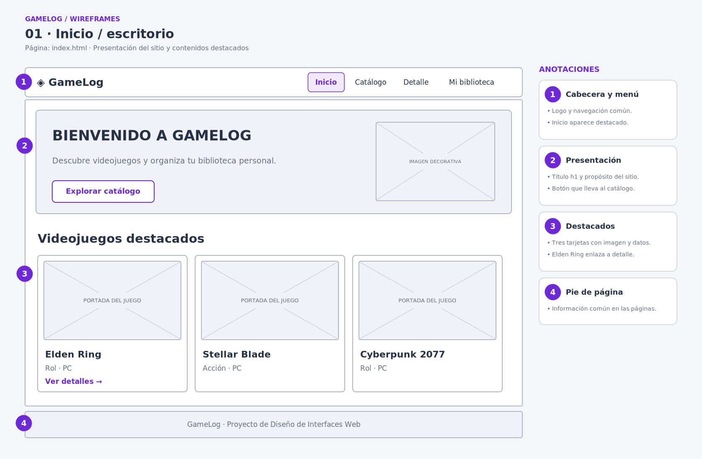
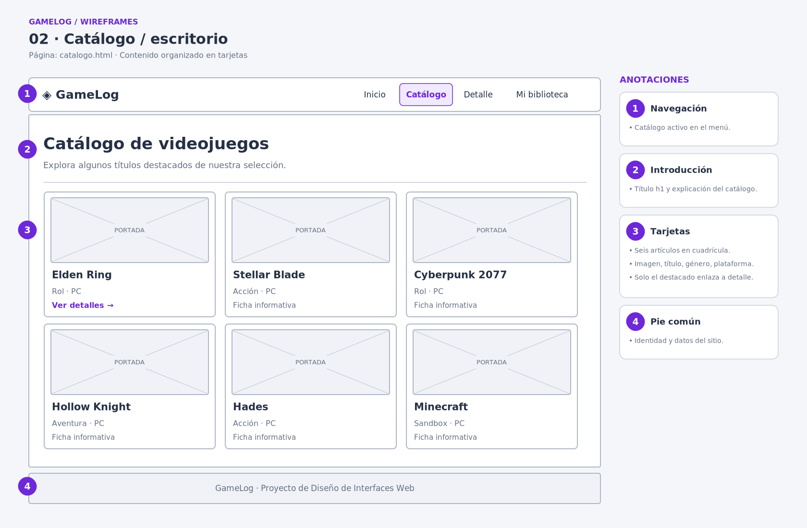
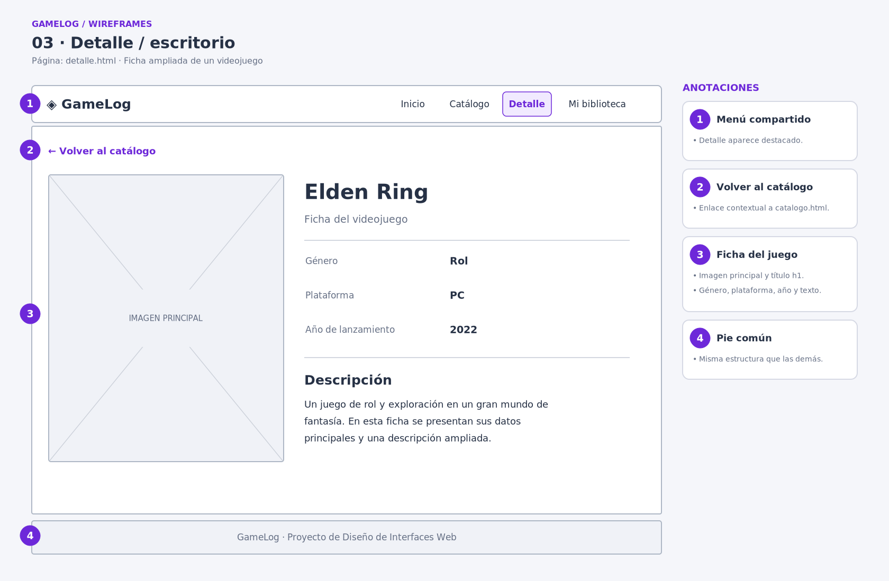
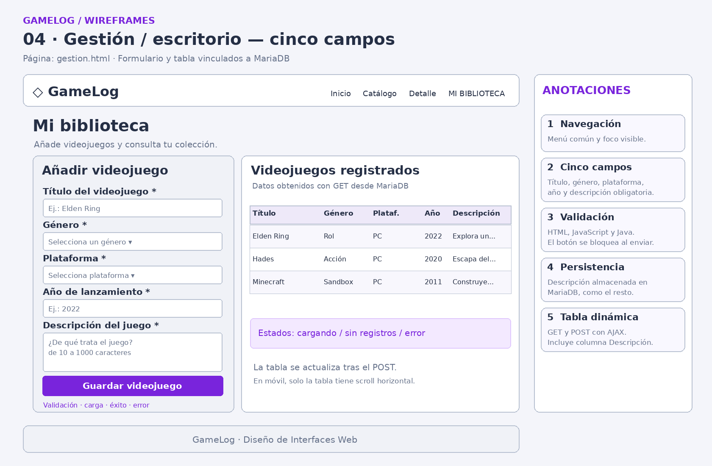
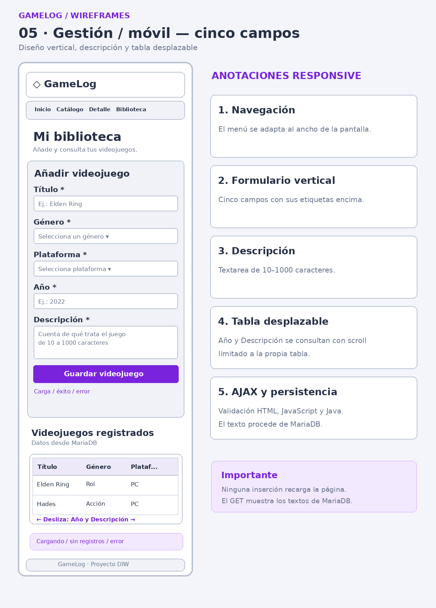

## Anexo A. Wireframes del sitio web GameLog

Los wireframes muestran la distribución prevista de las páginas y la jerarquía de sus contenidos antes de programar el sitio. Las imágenes contienen anotaciones numeradas. Los tonos morados se reservan para identificar elementos y explicaciones del boceto; el CSS definitivo seguirá la identidad visual aprobada de GameLog.

Las anotaciones de gestión mencionan MySQL porque corresponden al boceto inicial. El proyecto utilizará MariaDB en ambos entornos.

En la maqueta implementada, Portal 2 ocupa la tarjeta de Stellar Blade del boceto inicial. Cada tarjeta abre una ficha individual y la de Elden Ring sirve de ejemplo para la estructura común.

### A.1. Inicio - escritorio (`index.html`)

**Distribución:** cabecera y menú común, presentación del sitio con botón «Explorar catálogo», tres tarjetas de videojuegos destacados y pie de página.

**Jerarquía y navegación:** título principal `h1` «Bienvenido a GameLog»; sección de destacados con `h2`; enlace del botón hacia `catalogo.html` y enlace «Ver detalles» de Elden Ring hacia `detalle.html`. La opción «Inicio» se identifica como actual.

### A.2. Catálogo - escritorio (`catalogo.html`)

**Distribución:** cabecera, título y descripción del catálogo, cuadrícula de seis tarjetas con imagen, título, género y plataforma, y pie común.

**Jerarquía y navegación:** un `h1` para «Catálogo de videojuegos». Cada tarjeta podrá ser un `article` por representar una ficha independiente. La tarjeta de Elden Ring incluye «Ver detalles» hacia `detalle.html`. La opción «Catálogo» se identifica como actual.

### A.3. Detalle - escritorio (`detalle.html`)

**Distribución:** cabecera común, enlace de regreso al catálogo, imagen principal del videojuego, título, datos del juego, descripción ampliada y pie de página.

**Jerarquía y navegación:** `h1` «Elden Ring», `h2` «Descripción» y enlace «Volver al catálogo» hacia `catalogo.html`. La opción «Detalle» se identifica como actual.

### A.4. Gestión de datos - escritorio (`gestion.html`)

**Distribución:** cabecera común; título de «Mi biblioteca»; formulario de cinco campos obligatorios (incluida la descripción) y botón de envío; área de mensajes; y tabla de videojuegos registrados con encabezados.

**Interacción y estados:** al cargar, el listado se obtiene mediante GET al servicio Java. El formulario envía JSON mediante POST. Si se guarda correctamente, la tabla se actualiza sin recargar la página. El boceto señala zonas para validación, envío/carga, éxito, error de inserción, tabla vacía y error de consulta. Estos son **estados alternativos**, no mensajes que se presentarán todos a la vez.

### A.5. Gestión de datos - móvil (`gestion.html`)

**Adaptación responsive:** la navegación conserva acceso a las cuatro páginas, el formulario pasa a una sola columna y la tabla queda debajo. Si la tabla excede el ancho de la pantalla, solamente su contenedor podrá desplazarse lateralmente, evitando desplazamiento horizontal de toda la página. Los estados de carga y error siguen siendo visibles.

### Consideraciones compartidas

- Las cuatro páginas mantienen cabecera, navegación y pie coherentes.
- Se destacará la página actual en el menú.
- Se utilizarán etiquetas HTML semánticas, encabezados jerárquicos y enlaces significativos.
- Las imágenes informativas llevarán texto alternativo; las decorativas llevarán `alt=""`.
- Los formularios tendrán `label` asociado a cada control y la tabla tendrá `caption` y encabezados `th`.
- Los diseños son orientativos. Las imágenes del catálogo son ejemplos; los datos de la tabla de gestión se obtendrán realmente de MariaDB mediante el servicio web Java.

## Anexo B. Diseño semántico

| Página | Sección | Etiquetas previstas | Justificación |
| --- | --- | --- | --- |
| Todas | Cabecera, menú, contenido y pie | `header`, `nav`, `ul`, `main`, `footer` | Delimitan las zonas de navegación. El menú marca la página actual con `aria-current="page"`. |
| Inicio | Bienvenida y destacados | `section`, `h1`, `h2`, `article`, `h3` | La bienvenida explica el propósito. Cada tarjeta representa un juego independiente. |
| Catálogo | Selección de juegos | `h1`, `article`, `h2`, `img`, `a` | Los títulos permiten localizar cada ficha. Las portadas complementan el título y cada tarjeta enlaza a su ficha ampliada. |
| Detalle | Ficha y descripción | `article`, `h1`, `img`, `dl`, `dt`, `dd`, `section`, `h2` | La lista de descripción asocia cada dato con su nombre. La portada principal tiene un texto alternativo descriptivo. |
| Mi biblioteca | Alta | `section`, `form`, `label`, `input`, `select`, `button` | Cada control tiene una etiqueta visible. La zona de estado comunica el resultado del envío. |
| Mi biblioteca | Consulta | `section`, `table`, `caption`, `thead`, `tbody`, `th scope="col"` | El título identifica la tabla y los encabezados relacionan cada dato con su columna. |

### Actualización del wireframe de Gestión: descripción (12/11/2026)

En la versión implementada del formulario se incorpora el campo obligatorio **«Descripción del videojuego»**, un `<textarea>` de cinco filas, situado después del año y antes de Guardar. Admite de 10 a 1000 caracteres, validados por HTML, JavaScript y Java. La tabla añade la columna Descripción y mantiene su desplazamiento lateral propio en móvil. El catálogo muestra una versión resumida del texto; la página Detalle muestra la descripción completa procedente de MariaDB.
